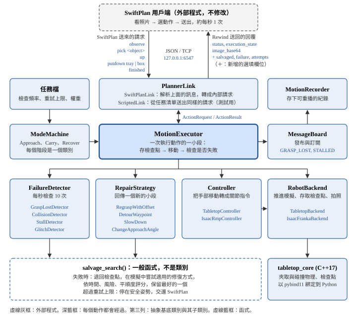

# Rewind

AOOP 2026 秋季期末專題（第 16 組）。

Rewind 讓模擬中的機械手臂在動作失敗時自己發現，並當場補救：退回先前存下的檢查點，只把失敗的那一小段換一種方式重做。它與 SwiftPlan 搭配運作：SwiftPlan 決定「做什麼」，Rewind 負責「怎麼做」，SwiftPlan 的程式碼不需修改。

## 目前狀態

提案階段，尚未有程式碼。完整提案見 [docs/proposal.md](docs/proposal.md)。

## 預計進度

| 里程碑 | 內容 |
| --- | --- |
| M1 骨架 | repo、CMake、pytest；抽象基底類別 |
| M2 C++ 模擬器 | `tabletop_core`：物理、狀態存取、pybind11 綁定 |
| M3 動作 | `Segment`、`MotionExecutor`、`ModeMachine`、`ScriptedLink` |
| M4 偵測與修復 | 四種失敗檢查、四種修復、`salvage_search`、`MessageBoard` |
| M5 量測與重播 | `MotionRecorder`、批次量測 |
| M6 SwiftPlan 與 Franka | `SwiftPlanLink`、`IsaacFrankaBackend`、`IsaacRmpController` |

## 語言與工具

Python 3.10+、C++17、pybind11、CMake、pytest
