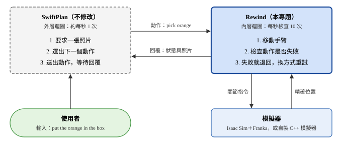
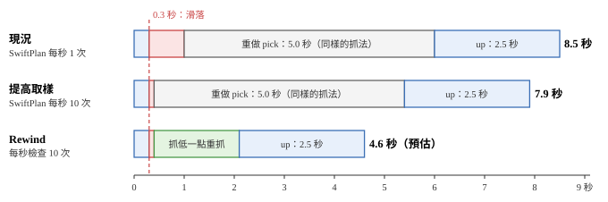
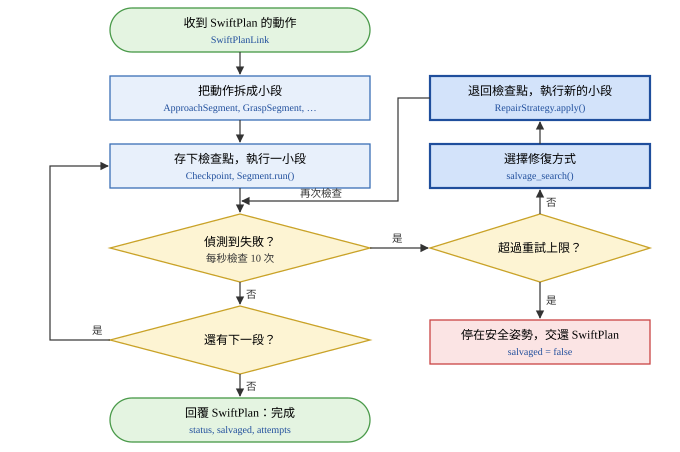
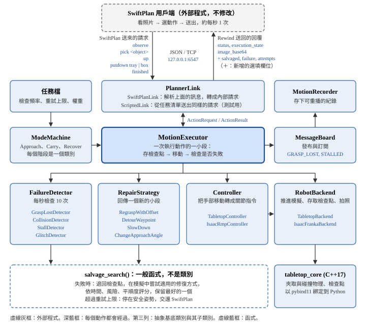

# AOOP 期末專題提案：Rewind

第 16 組　曾元昱

Repo：https://github.com/YuanYuTseng/AOOP_SWIFTRECOVERY

---

## 1. 專題簡介 (Overview)

Rewind 讓模擬中的機械手臂在動作失敗時自己發現，並當場補救：退回先前存下的檢查點，只把失敗的那一小段**換一種方式**重做。

它與 SwiftPlan 搭配運作。SwiftPlan [1] 是現有的 AI 模型，負責決定機器人下一步做哪個動作。SwiftPlan 繼續決定「做什麼」，Rewind 接手「怎麼做」；SwiftPlan 的程式碼完全不修改。

程式的組織原則：會變動的部分（機器人、失敗檢查、修復方式）寫成可互換的類別；不會變動的計算維持為一般函式。

## 2. 問題說明 (Problem)

### 2.1 SwiftPlan 已經做到的事

SwiftPlan 約每秒拍一張照片，再依照片選出下一個動作。物品滑落時，它會在下一張照片看到，並重新選擇 `pick`。Rewind 保留這個機制。

### 2.2 還缺少的部分

- **重試永遠是同一個動作。**重做的 `pick` 從同樣的高度下降、抓同樣的位置、跑同樣的固定影格數。若滑落的原因是抓法，我們預期它會再滑一次；發生的比例將在里程碑 M5 實測。
- **SwiftPlan 只能選動作，不能決定怎麼做。**它的輸出是固定清單中的一個標籤，無法要求抓低一點、抬慢一點或繞過障礙物。
- **有些失敗沒有對應的標籤。**手臂擦撞障礙物、停在目標前、或模擬器出錯時，唯一能做的還是重複同一個動作。
- **手臂端的程式不檢查自己的結果。**其檔頭 [1] 註明不檢查 `pick` 或 `up` 是否完成，且每個動作都跑固定的影格數。
- **現有程式無法直接加入修復功能。**它以約 34 個全域變數保存狀態。

對單次滑落，Rewind 只比 SwiftPlan 自己的恢復快幾秒；本專題要解決的是「重複同一個動作也修不好」以及「物理引擎造成的掉落」這兩類失敗。

## 3. Rewind 與 SwiftPlan 的溝通 (Communication with SwiftPlan)

### 3.1 兩個迴圈

兩個迴圈以不同速度運作：SwiftPlan 約每秒依照片決定一次動作；Rewind 在這一秒之內移動手臂，並每秒檢查 10 次動作是否失敗。

**圖 1 兩個迴圈與彼此傳遞的資料**

### 3.2 四條規則

以下規則避免兩個迴圈互相干擾；最壞情況等同於現在沒有 Rewind 的行為。

1. **SwiftPlan 有最終決定權。**它送來不同的動作時，Rewind 立刻停止（包含進行中的修復）並切換。
2. **同一個動作再送一次，代表「繼續」。**與現有伺服器的行為相同。
3. **場景穩定後才拍照。**Rewind 不會在偵測或退回的途中結束這一秒，SwiftPlan 不會看到做到一半的畫面。
4. **Rewind 會回報，也會乾淨地放棄。**修復方式用完時停在安全姿勢並回報，由 SwiftPlan 依下一張照片決定。

### 3.3 檢查頻率與延遲

檢查頻率定為每秒 10 次（任務檔參數 `check_hz`），理由如下：

- **手臂控制沒有變快。**模擬器與手臂指令維持每秒 60 步，與現有 SwiftPlan 伺服器相同。Rewind 只是每 6 步多做一次檢查。
- **檢查很便宜。**每次只讀取模擬器記憶體中已有的數值（位置、速度、接觸紀錄）並做幾次比較，不需算圖、影像編碼、網路傳輸或神經網路推論。設計預算為每次低於 1 ms，即每秒低於 10 ms；M5 將實測，超出預算就調低 `check_hz`。
- **SwiftPlan 看到的節奏不變。**仍是「送出動作 → 模擬 1 秒 → 收到回覆」。沒有失敗時，回覆時間與現在相同。
- **只有失敗時才多花時間，而且有上限。**修復最多嘗試 3 次，超過就交還 SwiftPlan。這段時間取代的是原本「整個動作重做」的時間。
- **不會漏掉短暫的碰撞。**模擬器每一步都記錄接觸，檢查時讀取這 6 步累積的紀錄。
- **每秒 10 次已經夠快。**最晚 0.1 秒發現滑落，此時物品約下落 5 cm、手臂只多抬 0.5 cm；每秒 1 次則最晚 1 秒，物品已落到桌面。

### 3.4 與「提高 SwiftPlan 取樣頻率」的差別

提高取樣頻率只能「早一點發現」，不能「換一種做法」，而且成本落在最貴的環節。

**表 1 三種做法的比較**

|   | 現況 SwiftPlan 每秒 1 次 | 提高取樣 SwiftPlan 每秒 10 次 | Rewind 每秒檢查 10 次 SwiftPlan 維持每秒 1 次 |
| --- | --- | --- | --- |
| 每秒多出的成本 | 無 | 多 9 次算圖、影像編碼、傳輸與模型推論，每次都要用到 GPU | 10 次數值比較（預算低於 10 ms） |
| 要改 SwiftPlan 嗎 | 否 | 要：伺服器以 1 秒為單位執行動作，用戶端迴圈也要改 | 否 |
| 看到的資訊 | 照片 | 照片，且包含動作做到一半的畫面 | 精確位置與接觸紀錄 |
| 發現滑落 | 最晚 1 秒 | 最晚約 0.1 秒 | 最晚 0.1 秒 |
| 發現後能做的事 | 再選同一個標籤，做同樣的動作 | 相同：再選同一個標籤，做同樣的動作 | 退回檢查點，改變抓取位置、速度或路徑 |
| 碰撞、停滯 | 只能重複同一動作 | 只能重複同一動作 | 有對應的修復方式 |

### 3.5 範例：抬升時柳橙滑落

SwiftPlan 送出 `up` 後 0.3 秒，柳橙從夾爪滑落。圖 2 比較三種做法完成抬升所需的時間。

**圖 2 同一次滑落的三種處理方式（紅色：尚未發現的時間）**

*前兩列依 SwiftPlan 程式的固定影格數換算（`pick` 300 格＝5.0 秒，`up` 150 格＝2.5 秒）；Rewind 的重抓以開、關夾爪共 100 格估計，將在 M5 實測。*

提高取樣只省下 0.6 秒，而且重做的仍是同樣的抓法；Rewind 不必重做整個 `pick`，並且換了抓取位置。三種做法中，SwiftPlan 最後都會看到柳橙被舉起，再送出下一個動作。

## 4. 單一動作內的處理 (Inside One Action)

### 4.1 處理流程

Rewind 把每個動作拆成小段，每段開始前存下檢查點；失敗時只修復失敗的那一段。

**圖 3 單一動作內的處理流程（深藍：只有失敗時才執行）**

### 4.2 處理的四種失敗

**表 2 失敗類型、偵測方式與修復方式**

| 失敗 | 如何發現 | 嘗試的修復 |
| --- | --- | --- |
| 抬升時物品滑落 | 物品不再跟著夾爪移動 | 退回，抓低或抓緊一點，放慢抬升 |
| 手臂擦撞障礙物 | 碰到目標以外的物體 | 退回，加一個較高的中繼點繞過 |
| 手臂到不了目標姿勢 | 與目標的距離不再縮短 | 換一個角度接近 |
| 模擬器出錯（物品下沉或飛走） | 不可能的速度或物體重疊 | 退回，放慢重做該段 |

### 4.3 其他功能與範圍

- **紀錄與重播：**每次執行都存檔，可重播到失敗發生的時刻。
- **兩種機器人：**自製的 C++ 桌面模擬器（不需 GPU），以及 Isaac Sim [2] 中的 Franka 手臂。
- **成效量測：**刻意製造失敗並批次執行，報告修復成功率、嘗試次數與耗時，並與「單純重複同一動作」比較。
- **不在範圍內：**訓練模型、在實體機器人上執行。退回檢查點只有在模擬器中才做得到。

## 5. 程式架構 (Program Structure)

### 5.1 系統架構圖

SwiftPlan 送來的每一則訊息都由 `PlannerLink` 接收並轉成內部請求，再交給唯一的 `MotionExecutor` 執行。`MotionExecutor` 只依賴抽象類別，任何子類別都可以替換。

**圖 4 Rewind 系統架構圖**

表 3 列出 SwiftPlan 的每一則訊息由哪個類別處理。

**表 3 SwiftPlan 的訊息與負責的類別**

| SwiftPlan 送來 | 負責的類別 | Rewind 做的事 |
| --- | --- | --- |
| `observe` | `RobotBackend` | 等場景穩定後拍照，回傳 `image_base64` |
| `pick <object>` | `ApproachSegment`、`GraspSegment` | 靠近、下降、夾取；每段之前存檢查點 |
| `up` | `LiftSegment` | 抬升；由 `GraspLostDetector` 監看是否滑落 |
| `putdown tray \| box` | `TransferSegment`、`ReleaseSegment` | 移到目的地上方並放開 |
| 同一個動作再送一次 | `MotionExecutor` | 接續未完成的小段（規則 2） |
| 不同的動作 | `MotionExecutor` | 中止目前的小段或修復，立刻切換（規則 1） |
| `finished` | `MotionRecorder` | 結束任務，存下紀錄 |

所有訊息都先經過 `SwiftPlanLink`。SwiftPlan 的訊息格式只出現在這一個類別裡；格式若改變，只需修改它。

### 5.2 分層

**表 4 程式分層**

| 層 | 內容 | 語言 |
| --- | --- | --- |
| 對外介面 | `PlannerLink`、任務檔、`MotionRecorder` | Python |
| 核心 | `MotionExecutor`、`ModeMachine`、`MessageBoard`、`Checkpoint`、`Segment` | Python |
| 可替換的類別 | `FailureDetector`、`RepairStrategy`、`Controller`、`RobotBackend` | Python |
| 演算法 | `salvage_search`、成本評分、軌跡內插 | Python 函式 |
| 模擬核心 | `tabletop_core`：夾取與碰撞物理、狀態存取 | C++17、pybind11 |

相依方向只往下。核心不匯入 Isaac Sim 也不匯入 SwiftPlan，因此兩者都沒安裝時，專案仍可建置並通過全部測試。

## 6. 物件導向設計 (Object-Oriented Design)

### 6.1 類別階層

類別用在會變動的地方：新增一種機器人、失敗類型或修復方式，只需要一個子類別加一行註冊。

**表 5 類別階層**

| 抽象基底類別 | 責任 | 子類別 |
| --- | --- | --- |
| `PlannerLink` | 接收動作、送出回覆 | `SwiftPlanLink`、`ScriptedLink` |
| `Segment` | 動作中的一小段 | `ApproachSegment`、`GraspSegment`、`LiftSegment`、`TransferSegment`、`ReleaseSegment` |
| `FailureDetector` | 監看一件事並回報失敗 | `GraspLostDetector`、`CollisionDetector`、`StallDetector`、`GlitchDetector` |
| `RepairStrategy` | 把失敗的小段變成新的小段 | `RegraspWithOffset`、`DetourWaypoint`、`SlowDown`、`ChangeApproachAngle`、`AbortToHome` |
| `Mode` | 帶有各自限制的動作階段 | `ApproachMode`、`CarryMode`、`RecoverMode` |
| `Controller` | 把手部移動轉成關節指令 | `TabletopController`、`IsaacRmpController` |
| `RobotBackend` | 推進模擬、存取狀態 | `TabletopBackend`、`IsaacFrankaBackend` |
| `Entity`（C++） | 模擬世界中的物體 | `Item`、`Container`、`Gripper`、`Obstacle` |

### 6.2 設計模式

`MessageBoard` 的概念取自課程 [3] 使用的 MOOS-IvP。

**表 6 使用的設計模式**

| 模式 | 位置 | 用途 |
| --- | --- | --- |
| Adapter | `SwiftPlanLink` | 使用 SwiftPlan 的訊息格式，SwiftPlan 不需修改 |
| Strategy | `Controller`、`RepairStrategy`、`RobotBackend` | 執行時替換行為，不必改 `MotionExecutor` |
| State | `ModeMachine` 內的 `Mode` | 每個階段自帶限制，取代一長串 `if` |
| Observer | `MessageBoard` | 各部分透過訊息互動，彼此不直接呼叫 |
| Memento | `Checkpoint` | 存取狀態而不暴露後端的儲存方式 |
| Template Method | `Segment.run()` | 存檢查點與失敗檢查只在基底類別寫一次 |
| Registry | `DetectorRegistry`、`RepairRegistry` | 依任務檔中的名稱建立物件 |
| Dependency Injection | `MotionExecutor(link, backend, …)` | 測試時可傳入假物件，沒有全域狀態 |

## 7. 進度與分工 (Milestones)

M4 完成時，完整流程已可在自製模擬器上運作；M6 接上 SwiftPlan。週數自提案通過起算。

**表 7 里程碑**

| 里程碑 | 週 | 內容 | 完成標準 |
| --- | --- | --- | --- |
| M1 骨架 | 1 | repo、CMake、pytest；抽象基底類別 | 測試在 CI 上執行 |
| M2 C++ 模擬器 | 2 | `tabletop_core`：物理、狀態存取、pybind11 綁定 | 「存檔 → 擾動 → 還原」測試通過 |
| M3 動作 | 3 | `Segment`、`MotionExecutor`、`ModeMachine`、`ScriptedLink` | 腳本化的夾取與放置在模擬器中完成 |
| M4 偵測與修復 | 4 | 四種失敗檢查、四種修復、`salvage_search`、`MessageBoard` | 四種刻意製造的失敗都在測試中被修復 |
| M5 量測與重播 | 5 | `MotionRecorder`、批次量測、檢查成本與碰撞效能量測 | 報告比較 Rewind 與「重複同一動作」 |
| M6 SwiftPlan 與 Franka | 6 | `SwiftPlanLink`、`IsaacFrankaBackend`、`IsaacRmpController` | 未修改的 SwiftPlan 用戶端透過 Rewind 完成一個任務 |
| M7 收尾 | 視時間 | 文件、示範影片 | 新使用者可依 README 執行示範 |

**分工：**曾元昱，負責上述全部里程碑。

## 8. 風險 (Risks)

**表 8 風險與對策**

| 風險 | 對策 |
| --- | --- |
| SwiftPlan 自己的恢復已經足夠，Rewind 幫助有限 | M5 以相同的失敗比較兩者，報告中如實說明何處有幫助、何處沒有 |
| 檢查增加系統延遲 | M5 量測每次檢查的耗時；超出預算就調低 `check_hz` |
| 修復途中，SwiftPlan 與 Rewind 意見不同 | 第 3.2 節的四條規則；SwiftPlan 有最終決定權 |
| Isaac Sim 無法精確退回檢查點 | 只還原手臂與物品的位置與速度；仍不可靠時，改為從目前狀態重做該段 |
| 組員或評分者沒有 Isaac Sim 或 SwiftPlan | M1 至 M5 與全部評分測試都在 C++ 模擬器上以 `ScriptedLink` 執行 |
| SwiftPlan 的程式碼沒有授權條款 | 只透過其訊息格式連接，不複製其程式碼；必要時改用 `ScriptedLink` 示範 |
| 範圍過大 | M1 至 M5 為必要核心；依序先刪 M7、再刪 M6 |

## 參考資料 (References)

1. SwiftPlan 程式碼：https://github.com/skylerkuo/swiftplan_code、https://github.com/skylerkuo/isaac_sim_swiftplan
2. NVIDIA, “Isaac Sim Documentation,” https://docs.isaacsim.omniverse.nvidia.com
3. AOOP 課程教材（2026 秋季）：https://github.com/ARG-NCTU/oop-2026-fall
